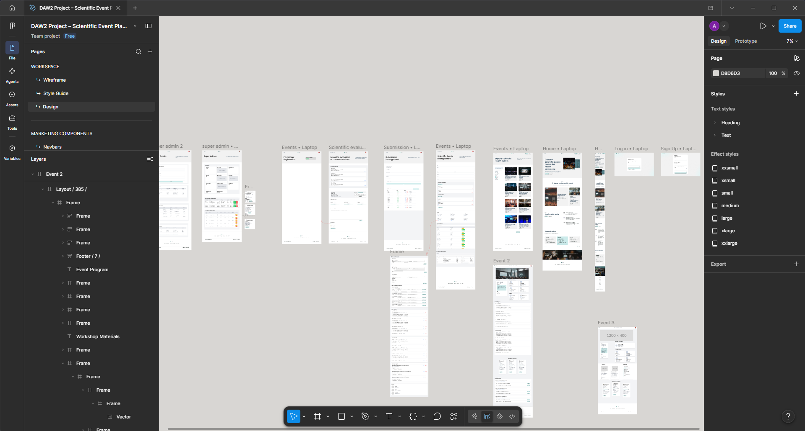
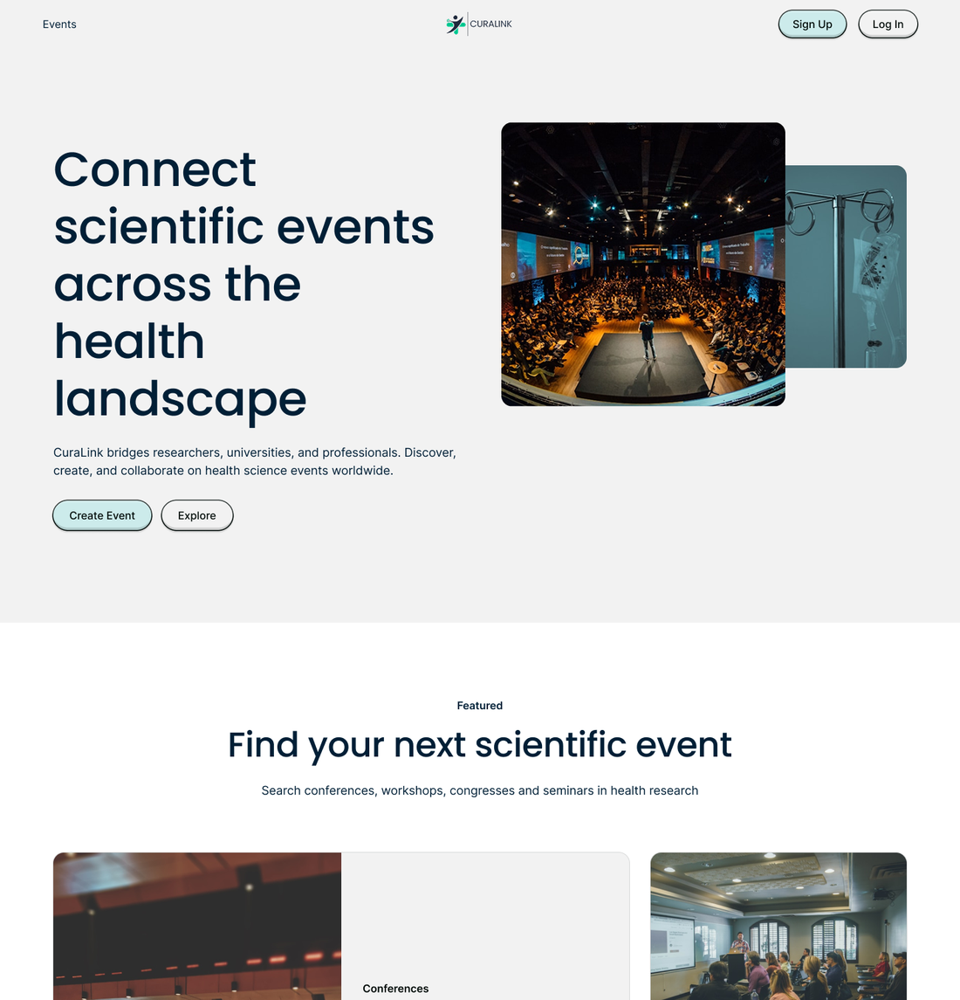
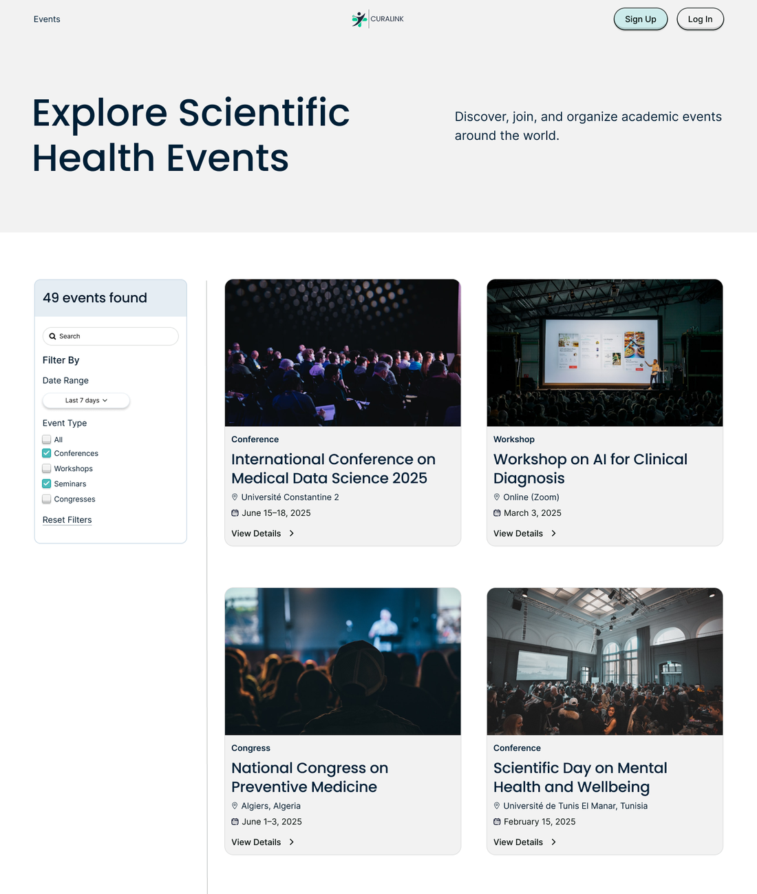
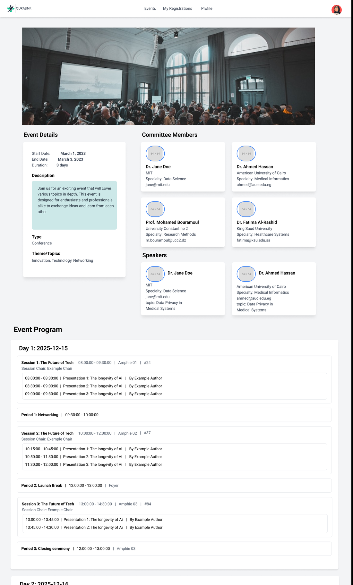
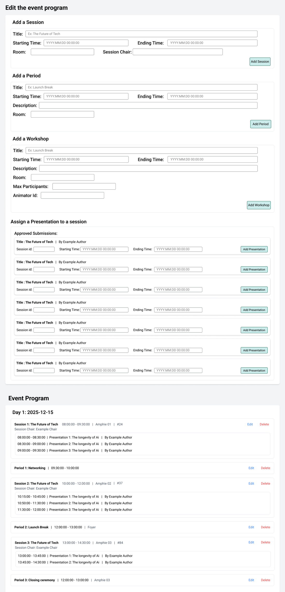
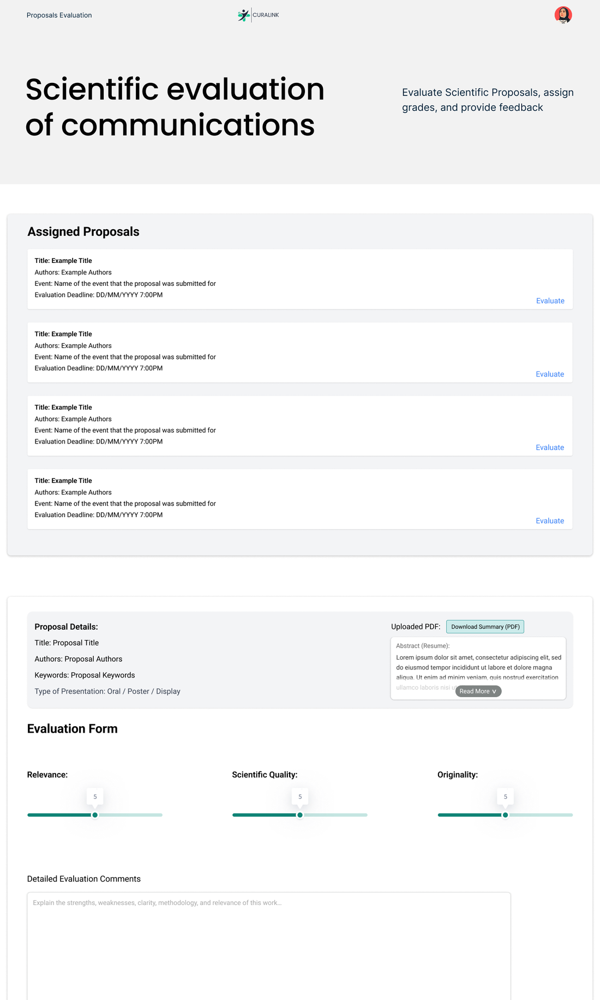

# CuraLink

**A web platform for managing health-related scientific events**: conferences, workshops, proposal review, scientific programs, live Q&A and surveys.
Developed by a team of three for the DAW2 module (L3 Information Technologies, Constantine 2 University, 2025/2026). Built with Laravel, Vue.js and MySQL.

**Project status.** The backend is complete for all 8 modules, and every API route was tested and validated in Postman. The Vue frontend, built by other members of the team, covers Modules 1 to 5; Modules 6 to 8 are implemented and tested at API level and designed in Figma, but not yet connected to the interface. This was a 1.5-month academic project, so finishing the full frontend was not expected.

> This repository is my fork of the team repository: <https://github.com/imene253/plateforme-web-de-gestion-d-v-nements-scientifiques>
>
> For project overview: [See Slides](docs/CuraLink-slideshow.pdf)

## What it does

CuraLink connects event organizers, authors, reviewers, speakers and participants in one place.

- **Organizers** create events, assign the scientific committee and speakers, build the program and manage workshops
- **Authors** submit proposals (with a PDF abstract) and follow their review status
- **Committee members** score proposals on relevance, scientific quality and originality, comment, and accept or reject them
- **Participants** register for events and workshops, ask questions during sessions and answer surveys
- **Super admin** approves organizer accounts and supervises the whole platform

Seven roles are enforced with Laravel-Permission (super admin, organizer, participant, author, committee member, speaker, workshop facilitator). Sensitive roles need super-admin approval after registration, to prevent spam and fake accounts.

## My contribution

I was the **team leader**, designed the **UI/UX**, and built the **backend and database** for three modules.

### Team leadership and project management
Coordinated the team, split the work into modules with defined roles (UI/UX, frontend, backend, database), and set the workflow: every member announces the module they are starting, and backend routes are tested in Postman before the frontend is connected.

### UI/UX design (Figma)
Designed the whole application in Figma: wireframes, a style guide, and high-fidelity screens for every role. See [Design](#design).

### Backend and database (complete, tested in Postman)
**Module 6: Scientific program management, validation and program view**
- Organizers create sessions (title, time, room, session chair) and program periods such as breaks and networking
- Time-overlap rules: no two sessions can overlap on the same day, none can fall outside the event dates, and periods cannot overlap sessions or other periods
- Accepted proposals are assigned to sessions as presentations, which must fit inside the session and cannot overlap each other
- Locking rules: a session or period cannot be edited or deleted once its day arrives, and presentations are locked when their session starts
- All time logic lives in a reusable `ProgramValidationTrait`, using Laravel's Carbon date library
- The finished program is publicly visible when the event starts

**Module 7: Workshops and side events**
- Organizers create workshops with a room, time, capacity and an assigned facilitator
- Workshops can run in parallel with sessions, but cannot fall outside the event or double-book a room
- Facilitators accept or remove registrations and upload materials that only registered participants can see
- The maximum capacity is enforced: no further registrations once it is reached

**Module 8: Questions/Answers and surveys**
- Participants ask questions and answer each other during a session, with name, role and profile picture shown next to each post
- Reddit-style upvoting sorts questions by popularity; clicking again removes your upvote, so nobody can vote twice
- When a session ends, a survey rating quality, relevance and organization is shown automatically
- Results are calculated three minutes after the survey closes and shown to the organizer per session

## Design

The whole interface was designed in Figma before development. These are design mockups with placeholder data.



### Landing page


### Event discovery


### Event page with program


### Program editor


### Proposal evaluation


## Tech stack

| Layer | Technology |
| --- | --- |
| Backend | Laravel (PHP), Laravel-Permission, Carbon |
| Frontend | Vue.js |
| Database | MySQL |
| Architecture | MVC, API-first |
| Design | Figma |
| Tools | Git/GitHub, Postman, Notion, XAMPP, Excalidraw |

Backend routes are documented in [`API_ENDPOINTS.txt`](API_ENDPOINTS.txt). Every route was tested and validated in Postman before being connected to the frontend.

## Getting started

Prerequisites: PHP, Composer, Node.js and MySQL (for example via XAMPP).

```bash
git clone https://github.com/Akram-Ad12/CuraLink.git
cd CuraLink
composer install
npm install
cp .env.example .env          # then set your MySQL credentials
php artisan key:generate
php artisan migrate
npm run dev                   # in one terminal
php artisan serve             # in another
```

## Team

Team of three: Akram Adoui (me), Imene Ramanoudjam and Djoumana Saidi.

## License

Academic project.
